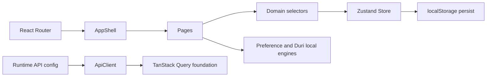

# 두리 (Duri)

> 취향이 다른 동행자와도 함께 결정하고, 실제 일정까지 완성할 수 있는 모바일 우선 협업 여행 플래너

두리는 여행방을 중심으로 장소 탐색, 후보 수집, 일정 편집, 여행 성향 분석을 하나의 흐름으로 연결한 프론트엔드 프로토타입입니다. 현재 버전은 부산 데모 여행방과 브라우저 로컬 데이터를 사용하며, 주요 MVP 사용자 흐름을 별도의 백엔드 없이 체험할 수 있습니다.

## 주요 기능

### 여행방과 동행자

- 참여 중인 여행과 지난 여행을 구분한 여행방 목록
- 여행 기간, 참여자, 후보 장소, 일정 반영 수 등 실제 Store 기반 통계
- 여행방 생성 Wizard와 여행방 홈
- 참여자별 여행 성향 응답 현황과 전체 진행 상태
- 현재 사용자만 응답하거나 자신의 결과를 확인할 수 있는 흐름

### 장소 탐색과 저장

- 추천 장소와 카테고리 기반 탐색
- 목록/지도 화면 간 URL 검색 조건 공유
- 장소 상세 정보 확인
- 개인 저장 목록과 여행방 후보 장소 추가
- 저장한 장소 및 후보 상태의 즉시 반영

### 일정 편집 워크스페이스

- 날짜별 일정과 후보 장소 보드
- 후보 장소 빠른 추가
- 일정 날짜, 시작 시간, 체류 시간 수정
- 드래그 앤 드롭을 통한 순서 변경 및 날짜 이동
- 키보드·버튼 기반 대체 조작
- 일정 겹침과 여행 기간 이탈 검증
- 새로고침 후에도 유지되는 편집 결과

### 여행 성향과 두리 분석

- 6문항 개인 여행 성향 테스트
- 사용자별 버전이 포함된 `UserPreferenceResult`
- 참여자 응답 결과를 이용한 그룹 성향 진단
- 일정의 동선, 밀도, 식사, 선호 적합도를 분석하는 로컬 엔진
- 결정론적으로 생성되는 두리 제안 미리보기 및 적용
- 오래된 제안과 충돌하는 변경을 방지하는 fingerprint 검증

### 데모 안정성

- Zustand persist 데이터 정규화 및 마이그레이션
- 잘못되거나 일부 누락된 로컬 데이터에 대한 방어 처리
- 공통 오류 경계, 빈 상태, 다이얼로그, 스크롤 잠금
- 모바일 전체 화면과 데스크톱 모바일 프레임 대응

## 현재 구현 상태

이 저장소는 **mock-first 프론트엔드 MVP**입니다.

| 영역 | 상태 | 비고 |
| --- | --- | --- |
| 핵심 여행 플로우 | 동작 | 목 데이터와 Zustand Store 사용 |
| 개인/그룹 성향 분석 | 동작 | 브라우저에서 로컬 계산 |
| 일정 분석 및 제안 적용 | 동작 | 로컬 두리 엔진 사용 |
| 로그인·회원가입·초대 | UI 준비 | 실제 인증이나 초대 요청은 전송하지 않음 |
| 카카오 로그인 | 비활성 표시 | OAuth 미연동 |
| 지도 | 데모 표현 | 실제 지도 SDK 미연동 |
| API 연동 | 기반 구조만 준비 | 실제 Swagger 계약 확인 후 서비스 구현 필요 |
| 실시간 협업 | 미구현 | 단일 브라우저의 로컬 상태로 동작 |

로그인 없이 시작하는 게스트 모드는 현재 세션에서만 유지됩니다. 이메일 가입, 초대 코드, 약관 화면은 실제 서버 계약을 추측하지 않도록 명시적인 placeholder로 구성되어 있습니다.

## 기술 스택

| 구분 | 기술 |
| --- | --- |
| UI | React 19, TypeScript |
| 빌드 | Vite 6 |
| 스타일 | Tailwind CSS 3 |
| 라우팅 | React Router |
| 클라이언트 상태 | Zustand, localStorage persist |
| 서버 상태 기반 | TanStack Query |
| 드래그 앤 드롭 | dnd-kit |
| 아이콘 | Lucide React |

## 시작하기

### 준비 사항

- Node.js와 npm
- 이 저장소는 Node.js `22.17.0` 환경에서 빌드를 확인했습니다.

### 설치 및 실행

```bash
git clone <repository-url>
cd duri-home-ui
npm install
npm run dev
```

브라우저에서 [http://127.0.0.1:5173](http://127.0.0.1:5173)으로 접속합니다.

환경 파일은 선택 사항입니다. 기본값을 명시하려면 다음과 같이 복사할 수 있습니다.

```bash
cp .env.example .env
```

Windows PowerShell에서는 다음 명령을 사용합니다.

```powershell
Copy-Item .env.example .env
```

## 환경 변수

```dotenv
VITE_DATA_SOURCE=mock
VITE_API_BASE_URL=http://localhost:3000/api/v1
VITE_DURI_ENGINE=local
```

| 변수 | 값 | 설명 |
| --- | --- | --- |
| `VITE_DATA_SOURCE` | `mock`, `api`, `hybrid` | 화면에서 사용할 데이터 소스 모드 |
| `VITE_API_BASE_URL` | URL | 향후 연결할 API 기본 주소 |
| `VITE_DURI_ENGINE` | `local`, `server` | 두리 분석 실행 위치 |

현재 완전히 동작하는 구성은 `mock` + `local`입니다. `api`, `hybrid`, `server` 모드는 설정과 공통 기반만 준비되어 있으며, 값을 변경하는 것만으로 백엔드가 연결되지는 않습니다.

## npm 명령어

| 명령어 | 설명 |
| --- | --- |
| `npm run dev` | 로컬 개발 서버 실행 |
| `npm run build` | TypeScript 검사 후 프로덕션 번들 생성 |
| `npm run preview` | 생성된 프로덕션 번들 미리보기 |

## 데모 동선

다음 순서로 현재 구현된 핵심 흐름을 확인할 수 있습니다.

1. `/`에서 진행 중인 부산 여행과 추천 장소를 확인합니다.
2. `/tests/personal`에서 6문항 성향 테스트를 완료하고 결과를 확인합니다.
3. `/trips`에서 여행방 통계와 진행 상태를 확인합니다.
4. `/explore` 또는 `/explore/map`에서 장소를 검색하고 저장합니다.
5. 장소 상세에서 부산 여행방의 후보 장소로 추가합니다.
6. `/trips/trip-busan-2026/workspace`에서 후보를 일정으로 옮기고 시간과 순서를 편집합니다.
7. 두리 분석 결과와 제안을 확인한 뒤 일정에 적용합니다.
8. `/saved`와 `/mypage`에서 누적된 사용자 데이터를 확인합니다.

새로운 여행방 생성 흐름은 `/trips/new`에서 체험할 수 있습니다.

## 주요 라우트

| 경로 | 화면 |
| --- | --- |
| `/` | 홈 |
| `/explore` | 장소 탐색 목록 |
| `/explore/map` | 장소 탐색 지도 |
| `/places/:placeId` | 장소 상세 |
| `/trips` | 내 여행방 목록 |
| `/trips/new` | 새 여행방 만들기 |
| `/trips/:tripId` | 여행방 홈 |
| `/trips/:tripId/workspace` | 일정 편집 워크스페이스 |
| `/tests/personal` | 개인 여행 성향 테스트 |
| `/tests/personal/result` | 개인 성향 결과 |
| `/duri` | 두리 분석 진입 화면 |
| `/saved` | 저장한 장소 |
| `/mypage` | 마이페이지 |
| `/login`, `/signup`, `/invite` | 인증·초대 UI placeholder |
| `/onboarding/profile`, `/onboarding/intro` | 온보딩 |
| `/terms` | 임시 약관 안내 |

## 구조

```text
src/
├─ app/          # Router, AppShell, 전역 오류 처리
├─ components/   # 공통 UI와 도메인 컴포넌트
├─ data/         # 통합 데모 데이터
├─ domain/       # 공통 도메인 타입
├─ features/     # 성향, 그룹 진단, 두리 분석, 인증 UI adapter
├─ hooks/        # 공통 화면 동작 및 접근 제어 hook
├─ lib/          # API client, Query client, 런타임 설정
├─ pages/        # 라우트 단위 화면
└─ store/        # Zustand Store, selector, persist 정규화
```



화면에서는 Store 전체를 구독하기보다 필요한 selector를 사용합니다. 후보 장소 수, 일정 반영 수, 참여자 응답률, 마이페이지 통계도 별도 하드코딩 값이 아니라 현재 상태에서 계산합니다.

## 데모 데이터 초기화

데모 상태는 브라우저의 `duri-mvp-store` localStorage 항목에 저장됩니다. 처음 상태로 되돌리려면 개발자 도구에서 해당 항목을 삭제한 후 새로고침합니다.

```js
localStorage.removeItem('duri-mvp-store')
location.reload()
```

Store는 이전 데이터 버전과 불완전한 데이터를 정규화하도록 구성되어 있지만, 스키마를 크게 변경한 뒤에는 초기화가 필요할 수 있습니다.

## 검증

- `npm run build`로 TypeScript 검사와 Vite 프로덕션 빌드 수행
- 360px, 375px, 390px, 430px 너비의 모바일 뷰포트 점검
- 홈 → 성향 테스트 → 여행방 생성 → 장소 저장/후보 추가 → 일정 편집 → 두리 분석 → 마이페이지 흐름 점검
- 직접 URL 진입, 존재하지 않는 ID, 다이얼로그 Escape, 스크롤 잠금 점검
- 새로고침 후 Zustand persist 복원과 손상 데이터 정규화 점검

상세 QA 기록은 [`docs/DEMO_QA.md`](docs/DEMO_QA.md)에서 확인할 수 있습니다.

## 알려진 제한 사항

- 실제 인증, 회원가입, 카카오 OAuth, 동행자 초대 API가 없습니다.
- 서버 데이터 동기화와 다중 사용자 실시간 협업이 없습니다.
- 실제 지도 SDK, 길찾기, 이동 시간 API가 연결되어 있지 않습니다.
- 이미지 제공처의 네트워크 상태에 따라 일부 외부 이미지가 표시되지 않을 수 있습니다.
- 일부 초기 번들 크기가 500 kB를 넘어 Vite 경고가 발생하며, 추후 라우트 단위 코드 분할이 필요합니다.
- 법적 약관 화면은 최종 약관이 아닌 UI 안내용 임시 콘텐츠입니다.

## 다음 단계

1. 실제 Swagger 또는 백엔드 소스 기준으로 인증·사용자·퀴즈·여행방 DTO 확정
2. 공통 API client 위에 도메인별 service와 mapper 구현
3. 읽기 전용 query부터 목 데이터와 병행 연결
4. 인증 토큰 수명 주기와 보호 라우트 정책 확정
5. 실제 지도·장소·이동 시간 데이터 연결
6. 초대 및 여행방 실시간 동기화
7. 라우트 단위 lazy loading과 번들 최적화
8. 자동화 테스트와 CI 구축

백엔드 연동 전제와 확인되지 않은 계약은 [`docs/BACKEND_CONTRACT_AUDIT.md`](docs/BACKEND_CONTRACT_AUDIT.md), 화면 이식 검토 내용은 [`docs/TRAVEL_CLIENT_MIGRATION_AUDIT.md`](docs/TRAVEL_CLIENT_MIGRATION_AUDIT.md)에서 확인할 수 있습니다.

## 프로젝트 원칙

- 모바일 사용성을 우선합니다.
- 기존 화면의 색상, 간격, 문구와 상호작용을 일관되게 유지합니다.
- 통계와 진행률은 실제 Store 데이터에서 계산합니다.
- 서버 계약이 확인되지 않은 기능은 성공한 것처럼 모사하지 않습니다.
- 도메인 데이터에 UI 컴포넌트나 Tailwind class를 섞지 않습니다.
- 핵심 사용자 흐름은 키보드와 터치 환경 모두에서 사용할 수 있도록 구현합니다.

